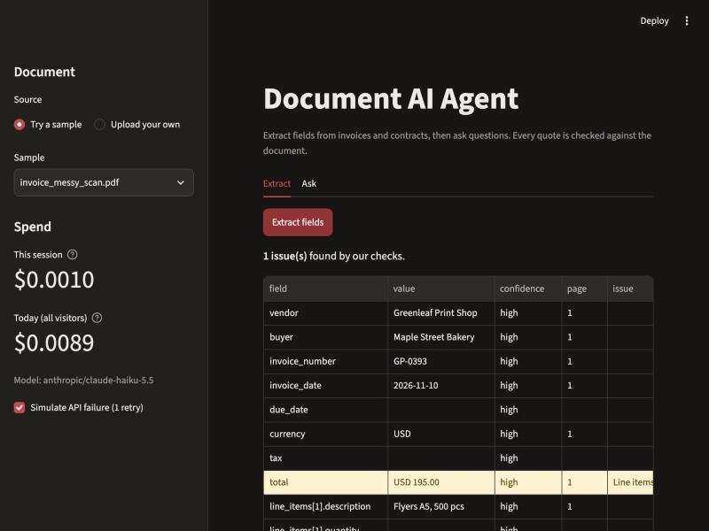
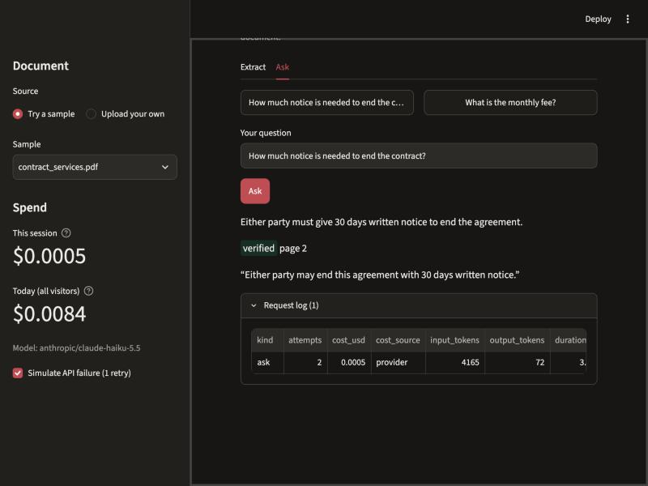

# Document AI Agent

Upload an invoice or a contract (PDF, scan or photo) and get its fields as a clean table. Then ask questions about it. The model's answers come with quotes, and **the app checks every quote against the document text itself** instead of trusting the model.

It is a small demo, but it is built the way production AI features should be: costs are visible, failures are retried and explained, the model's output is validated by plain code, and spending is capped.

| Extraction with checks | Answers with verified quotes |
|---|---|
|  |  |

## What it shows

- **Field extraction** for invoices (vendor, buyer, dates, line items, tax, total) and contracts (parties, term, fees, payment terms, termination notice, governing law). The answer shape is enforced with structured outputs.
- **Checks that are not AI**: line items plus tax must add up to the total, the due date cannot be before the invoice date, required fields must be present, and anything the model was unsure about is flagged. Problem rows are highlighted.
- **Verified quotes**: each quote in an answer is searched for in the PDF's own text. `verified` means it is really there (if the model named the wrong page, the real page is shown). `not found in document` means the model made it up. Scans and photos have no text layer, so their quotes are marked `unverified`.
- **Cost per request**, taken from the provider's billing data, plus the session and daily totals.
- **Retries you can see**: rate limits, server errors and timeouts are retried with backoff, and the request log shows how many attempts each call took.
- **Spend limits**: $0.10 per browser session and $1 per day by default. Failed requests that were still billed count too.
- **Cached fallback**: the bundled samples have pre-computed results, so they still work without an API key, when the budget is used up, or when the API is down.
- **CSV and JSON export**, with spreadsheet formula injection neutralized.

## How it works

```
upload ──► type + size + page checks ──► Claude Haiku 5.5 (via OpenRouter)
                                              │  structured output
                                              ▼
                                   deterministic checks ──► table, flags, CSV / JSON
question ──► Claude Haiku 5.5 ──► answer + quotes ──► quote check against PDF text ──► badges
```

The core (`doc_agent/`) has no UI code. `app.py` is a thin Streamlit layer on top of it.

| Module | Job |
|---|---|
| `documents.py` | File type by content, size and page limits, per-page text |
| `llm.py` | The only place that calls the model: retries, error messages, cost, budget |
| `extract.py`, `validate.py` | Extraction, checks, export |
| `ask.py` | Questions and quote verification |
| `budget.py`, `cost.py` | Daily and per-session limits, cost calculation |
| `cache.py`, `session.py` | Cached sample results and per-visitor session logic |

## Run it locally

```bash
uv sync
cp .env.example .env        # put your OpenRouter key in OPENROUTER_API_KEY
uv run streamlit run app.py
```

Without a key the app still runs: the samples show cached results. Set `DEMO_DEV=1` to get a "simulate API failure" switch for trying the retry logic.

## Switch provider or model

The model is reached through OpenRouter's Anthropic-compatible endpoint with the official `anthropic` SDK. To call Anthropic directly or use another model, change three values:

```bash
DOC_AGENT_BASE_URL=https://api.anthropic.com
DOC_AGENT_MODEL=claude-haiku-5-5
OPENROUTER_API_KEY=<your key>   # sent as a bearer token
```

## Scaling up

The demo sends whole documents to the model, which is right for a handful of files. For large archives, add retrieval over document chunks so each question only sends the relevant pages.

## Tests

```bash
uv run pytest --cov=doc_agent      # unit tests, no network
uv run pytest -m live              # one real API call, costs a fraction of a cent
```

Sample documents are generated by `scripts/make_samples.py` and all their content is fictional. `scripts/build_cache.py` refreshes the cached sample results.
